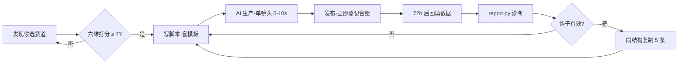

# AiViedo · AI 短视频工作台

> 一个仓库装下 AI 短视频的**全流程**：选赛道 → 写脚本 → 生产 → 发布 → 数据复盘。
> 它同时是三样东西：**知识库**（方法论与提示词）、**数据台账**（发了什么、跑得怎样）、**工具集**（打分与统计脚本）。

---

## 这个仓库解决什么问题

做 AI 短视频最容易死在两件事上：**凭感觉选赛道**，和**发完不看数据**。

这个仓库用两套机制把它们固定下来：

1. **赛道必须打分才能立项** —— 六个维度量化，总分 ≥ 7 才允许开做（`scripts/track_score.py`）
2. **每条视频必须登记** —— 发布即入库，3 秒完播率与完播率是硬字段（`data/videos.csv`）

只要台账不断，三个月后你就能看出「哪类钩子在我这个赛道真的有效」，而不是靠猜。

---

## 当前结论（2026-11 修订）

跑完六维打分后，方向做了修正，完整依据见 [`docs/08-路线汇总与决策规则.md`](docs/08-路线汇总与决策规则.md)：

| 赛道 | 总分 | 结论 |
|---|---|---|
| T06 面向创作者的素材 / 模板包（B 端） | 7.10 | 立项（观察） |
| T07 Fiverr / Etsy 定制接单（海外） | 7.05 | 立项（观察） |
| T04 小红书·AI 头像 / 宠物肖像定制 | 7.05 | 立项（观察） |
| T08 Etsy / Adobe Stock 数字素材（海外） | 6.85 | 观察 |
| T03 小红书·AI 原创角色壁纸 + 头像素材包 | 6.85 | 观察（只许试水） |
| T09 抖音图文星图任务（需 1000 粉） | 6.70 | 观察 |
| T10 AI 原创角色剧情视频（可接商单） | 6.00 | 观察 |
| T05 短视频流量号（抖音 / Shorts 纯做号） | **5.15** | **放弃** |
| T12 AI 工具教学 / 提示词号 | **4.90** | **放弃** |
| T11 视觉奇观 AI 视频（纯风景 / 未来城市） | **4.50** | **放弃** |

五条结论：

1. **纯短视频流量号不及格。** 卡在 `score_money = 3`——国内短视频无播放分成，变现必须先攒粉；海外需 90 天内 1000 万播放，一个人一天一小时数学上不成立。
2. **排序依据不是「哪个看起来大」，是「0 粉能不能收钱」。** 0 粉可收钱的只有：小红书薯店、Fiverr 定制、Etsy 数字下载、图片素材库。抖音（1000 粉解锁橱窗与星图图文）、TikTok（8 国）、Shorts（1000 万播放）全部锁在粉丝后面。
3. **壁纸素材包只到「观察」档。** 起量容易、涨粉一般、**变现最难**；四件套合计天花板约 ¥1500–8000/月，是地基不是终点。破局靠换市场（海外单价高 5–10 倍）、换客群（B 端/包月），不是换品类。
4. **视频要做，但只做「角色剧情」这一种，每周 2 条。** 三种 AI 视频的商单命运差 10 倍：角色剧情 6.00（可接玩具/盲盒/文具/宠物/游戏）、工具教学 4.90（粉丝是技术直男，非 AI 品牌投不进去）、纯视觉奇观 4.50（品牌不知道投给谁看）。视频是**广告位**（涨粉、接商单、一次性现金），图文是**货架**（被搜到、成交、复利），两者共用同一批角色素材。完整依据见 [`docs/10-双线并行与商单路径.md`](docs/10-双线并行与商单路径.md)。
5. **别把商单当主线。** 2026 上半年抖音端 AI 短剧 22.19 万部，播放破亿仅 0.47%；万粉以上 AI 创作者已出现集体停更，原因是单条成本上千而商单报价下跌。抗出清的是角色 IP 与数字产品，不是接单量。

落地动作见 [`docs/07-图文赛道落地清单.md`](docs/07-图文赛道落地清单.md)，阶段推进与 6 周决策规则见 [`docs/08-路线汇总与决策规则.md`](docs/08-路线汇总与决策规则.md)。

---

## 快速开始

```bash
git clone git@github.com:jayroundroundpineapple/AiViedo.git
cd AiViedo

# 1. 评估一个想做的赛道
python3 scripts/track_score.py

# 2. 发布一条视频后登记
python3 scripts/new_video.py

# 3. 攒够 10 条后看复盘
python3 scripts/report.py
```

三个脚本只依赖 Python 3 标准库，不需要装任何东西。

---

## 目录结构

```
AiViedo/
├── README.md                  ← 你在这里
├── docs/
│   ├── 00-方法论.md            AI 短视频从 0 到 1 的完整方法
│   ├── 01-数据规范.md          字段定义、命名规则、提交规则
│   ├── 02-合规红线.md          标识办法、备案、版权、抓取边界
│   ├── 03-赛道评估模型.md      六维打分法与决策阈值
│   ├── 04-SOP-单条视频生产.md  从选题到发布的 6 步清单
│   ├── 05-赛道发现与数据来源.md 合法获取数据的四类渠道
│   ├── 06-平台选择与变现优先级.md 国内 vs 海外、起号三层拆解、赛道打分结论
│   ├── 07-图文赛道落地清单.md  第一周 7 天与 30 天节奏
│   ├── 08-路线汇总与决策规则.md 变现权限表、收入天花板测算、阶段推进与 6 周决策规则
│   ├── 09-视频执行方案.md      四条视频线（L1-L4）、三种模板、按周排期、七种变现路径
│   ├── 10-双线并行与商单路径.md 图文+视频分工、真实报价表、三种视频的商单命运、7 小时周排期
│   └── 11-启动执行手册.md      三个方向对照、角色卡模板、四层选品、30 天排期、20 个标题
├── data/
│   ├── tracks.csv             赛道库（候选 / 在跑 / 已放弃）
│   ├── videos.csv             视频发布台账（核心表）
│   ├── notes.csv              图文发布台账
│   ├── metrics.csv            数据快照（同一视频的多时点记录）
│   └── raw/                   原始导出（不入库）
├── prompts/
│   ├── 01-选题.md             找钩子、找反常识
│   ├── 02-脚本.md             60 秒脚本结构
│   ├── 03-分镜与画面.md       单镜头 prompt 写法
│   └── 04-标题与封面.md       标题公式与封面文案
├── templates/
│   ├── 脚本模板.md
│   └── 复盘模板.md
├── scripts/
│   ├── track_score.py         赛道六维打分
│   ├── new_video.py           交互式登记一条视频
│   └── report.py              台账统计与诊断
└── knowledge/
    └── ai-short-video-guide.html   可视化版方法论（手机可直接看）
```

---

## 四条铁律

**1. 不提交凭据与隐私**
`.env`、cookie、抓取到的用户昵称/头像/主页链接，一律不入库。`.gitignore` 已经挡掉了常见项，但提交前请自己 `git status` 看一眼。

**2. 不内置爬虫，只处理公开数据**
平台条款普遍禁止自动化抓取。本仓库只做**人工录入 + 公开榜单/官方开放数据**的整理。详见 `docs/02-合规红线.md`。

**3. 每条视频都要有 `video_id`**
格式 `YYYYMMDD-平台-序号`，例如 `20261109-dy-01`。这是台账、快照、成片文件三者对齐的唯一主键，缺了就对不上。

**4. 数据字段不许留空**
跑不动的指标填 `0` 或 `NA`，但**不许空着**。空值会让统计脚本静默算错，比填错更难查。

---

## 数据字段速查

`data/videos.csv` 的 15 个核心字段：

| 字段 | 含义 | 示例 |
|---|---|---|
| `video_id` | 主键 | `20261109-dy-01` |
| `publish_date` | 发布日期 | `2026-11-09` |
| `platform` | 平台代码 | `dy` / `xhs` / `bl` / `sph` |
| `track` | 赛道代码 | `T01` |
| `form` | 形态 | `ai_full` / `digital_human` / `ai_assisted` |
| `hook_type` | 前 3 秒钩子类型 | `反常识` / `结果前置` / `冲突` / `痛点` / `悬念` |
| `duration_sec` | 时长（秒） | `58` |
| `shots` | 镜头数 | `8` |
| `cost_min` | 生产耗时（分钟） | `240` |
| `views_72h` | 72 小时播放 | `12400` |
| `rate_3s` | 3 秒完播率 | `0.42` |
| `rate_complete` | 完播率 | `0.18` |
| `likes` / `comments` / `shares` / `saves` / `follows` | 互动 | 整数 |
| `notes` | 一句话结论 | `钩子有效，中段掉量` |

完整定义见 `docs/01-数据规范.md`。

图文笔记走 `data/notes.csv`，核心指标换成「封面点击率 / 收藏率 / 搜索进入占比」，字段说明见 `docs/07-图文赛道落地清单.md`。

---

## 工作流



---

## 现在最该做的一件事

不是注册公司，不是搭系统，是**用现成工具做 10 条样片发出去**，看有没有陌生人问「多少钱」。

这个仓库的价值在**第 11 条之后**才开始释放——那时你有了自己的数据，别人的方法论就不如你的台账准。

---

## 合规提醒

本项目涉及 AI 生成内容，在中国境内发布需遵守《人工智能生成合成内容标识办法》（2025-09-01 施行），**必须添加显式标识与隐式元数据标识**。剪映等平台已因标识问题被查处。发布前请过一遍 `docs/02-合规红线.md`。

---

## Roadmap

- [x] 目录骨架与四份核心文档
- [x] 赛道六维打分脚本
- [x] 发布台账与复盘统计
- [x] 平台选择与变现优先级决策记录（`docs/06`）+ 图文台账 `data/notes.csv`
- [x] 路线汇总与决策规则（`docs/08`）：变现权限表 + 阶段推进 + 6 周决策规则
- [x] 视频执行方案（`docs/09`）+ 双线并行与商单路径（`docs/10`）：真实报价表、三种视频的商单命运、7 小时周排期
- [x] 启动执行手册（`docs/11`）：方向三选一、角色卡模板、四层选品、30 天排期、20 个标题
- [ ] 商单报价计算器（近 30 天互动中位数 × CPE × 内容系数）
- [ ] 图文数据的统计脚本（点击率 / 收藏率 / 搜索占比诊断）
- [ ] 海外接单 SOP（Fiverr Gig 文案、作品集清单、改稿边界）
- [ ] 竞品爆款库（人工录入模板 + 拆解字段）
- [ ] 单条视频成本核算（含 API 调用成本）
- [ ] 多平台同一条内容的差异化改写对照表
